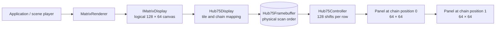

# HUB75 panel chains

`Hub75Display` presents every chain as one logical canvas. The panel grid and
chain order are compile-time configuration; drawing code only sees ordinary
pixel coordinates.



For two horizontal 64 by 64 panels, declare a 2 by 1 grid:

```livt
display: Hub75Display<2, 1>

new(panelClock: out logic, latch: out logic, outputEnableN: out logic,
	row: out logic[5], rgbUpper: out logic[3], rgbLower: out logic[3])
{
	display = new Hub75Display<2, 1>(panelClock, latch, outputEnableN,
		row, rgbUpper, rgbLower)
}
```

The resulting drawing surface is 128 by 64 pixels. `Hub75Display` shifts 128
pixel pairs before each latch. A single-panel declaration uses the defaults and
therefore remains a 64 by 64 surface.

`Hub75ChainOrder.RowMajor` numbers logical tiles left to right, then top to
bottom. Position zero is shifted first and reaches the panel farthest from the
controller after the complete row transfer. Use `RowMajorReverse` when the
physical cable begins at the other logical edge. `Serpentine` and
`SerpentineReverse` alternate direction on successive panel rows.

All panels in one chain share row address, latch and output-enable signals. They
must therefore use the same panel dimensions and scan ratio. The grid can be
horizontal or vertical, but it does not model mixed panel types.

`MatrixRenderer.Render` treats the bitmap as one canvas. `RenderTiled` repeats a
bitmap across the canvas, which is useful for mirrored content. `RenderPanel`
draws into one selected tile and leaves the other tiles black. The scene format
can use these presentation choices without encoding cable order; wiring remains
the responsibility of `Hub75Display`.

Small panel-to-panel color differences can be corrected with 8.8 fixed-point
gains. Neutral is 256, and gains up to 512 are accepted. Rendering writes every
visible source pixel through this calibration path:

```livt
// Reduce green on the second panel by about four percent.
display.SetPanelGain(1, 0, 256, 246, 256)
```
